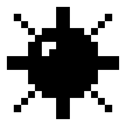
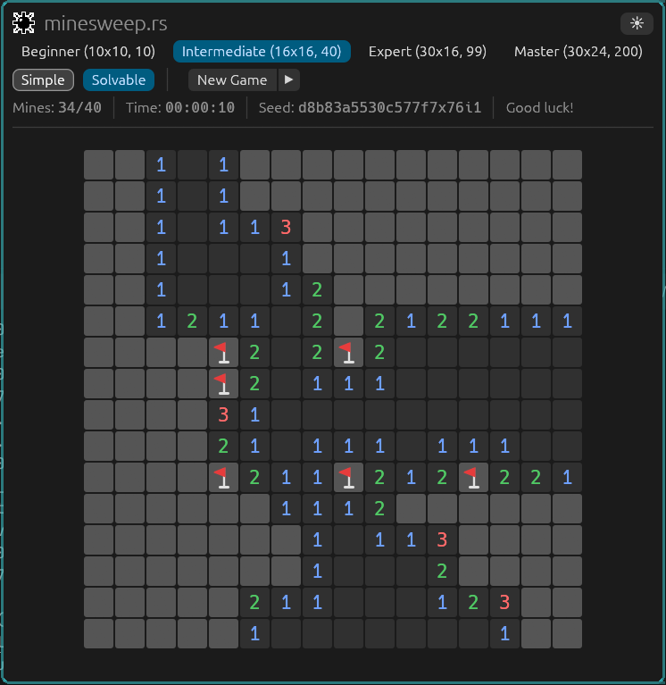

<p align="center">  </p> <h1 align="center">minesweep.rs</h1>

A Minesweeper game where every board can be solved by pure logic, with no guessing required. Inspired by the Minesweeper in [Simon Tatham's Portable Puzzle Collection](https://www.chiark.greenend.org.uk/~sgtatham/puzzles/). Built in Rust with [egui](https://github.com/emilk/egui).

**[Play in your browser](https://cliford.net/demos/minesweeper)** (WebAssembly build)

<p align="center">
  
</p>
## How to play

- **Left click** to reveal a cell
- **Right click** to flag or unflag a cell
- Numbers show how many mines are in the neighbouring cells
- Reveal every safe cell to win

## Building

### Native

```sh
cargo run --release
```

### Web (WASM)

Using [Trunk](https://trunkrs.dev/):

```sh
trunk serve --release
```

Then open `http://127.0.0.1:8080`.

## Links

- https://cliford.net/posts/minesweeper
- https://cliford.net/projects/minesweeper
